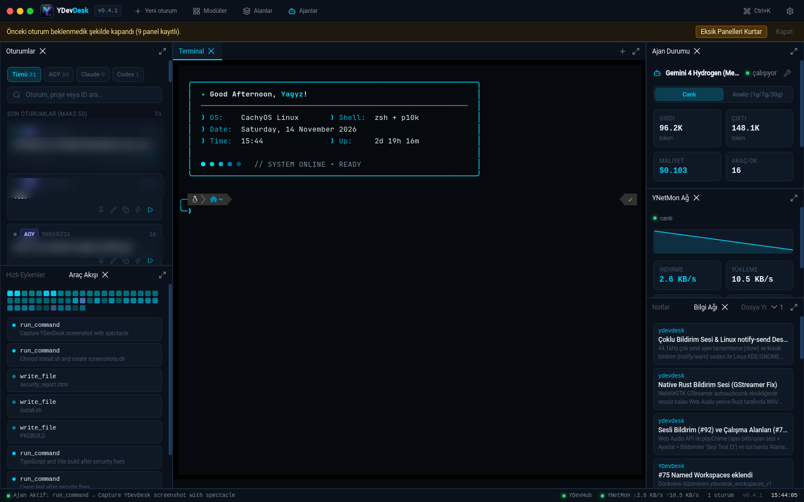
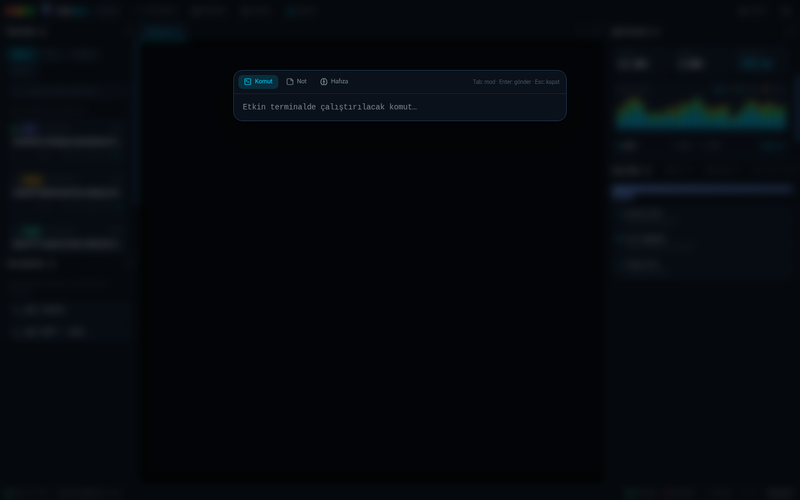

# YDevDesk — Homelab & Multi-Agent Desktop Command Center

[](LICENSE)
[](https://tauri.app)
[](https://react.dev)
[]()

**YDevDesk**, yapay zeka kodlama ajanlarını (**Antigravity / AGY**, **Claude Code**, **OpenAI Codex**), yerel PTY terminallerini ve Homelab servislerini (**YDevHub**, **YNetMon**, **Git/GitHub**) tek bir modüler masaüstü komuta merkezinde birleştiren **Tauri v2 (Rust) + React 19 + Dockview** uygulamasıdır.

🌐 **Web Sitesi:** [yagyz.github.io/YDevDesk](https://yagyz.github.io/YDevDesk/)



### 📸 Ekran Görüntüleri

| 30 Günlük Token & Maliyet Analizi | Komut Paleti (`Ctrl+K`) |
|---|---|
|  |  |

---

## ⚡ Hızlı Kurulum (Tek Komut)

Linux (Arch / CachyOS, Debian / Ubuntu, Fedora) ve macOS üzerinde dağıtımı otomatik algılayan tek satır kurulum:

```bash
curl -fsSL https://raw.githubusercontent.com/YagYz/YDevDesk/main/install.sh | bash
```

### Paket Yöneticileri ile Kurulum

| Platform | Kurulum Yöntemi | Komut |
|---|---|---|
| **Arch / CachyOS** | Tek Komut (`install.sh`) | `curl -fsSL https://raw.githubusercontent.com/YagYz/YDevDesk/main/install.sh \| bash` *(AUR kayıtları geçici olarak kapalı)* |
| **Debian / Ubuntu (APT)** | Resmi YDevDesk APT Deposu | `echo 'deb [trusted=yes] https://yagyz.github.io/YDevDesk/apt ./' \| sudo tee /etc/apt/sources.list.d/ydevdesk.list && sudo apt update && sudo apt install -y ydevdesk` |
| **Linux (Genel)** | AppImage | `chmod +x ydevdesk_*.AppImage && WEBKIT_DISABLE_DMABUF_RENDERER=1 ./ydevdesk_*.AppImage` |
| **macOS (Apple Silicon / Intel)** | İmzasız `.dmg` | Uygulamayı `/Applications` içine taşıyıp ilk açılışta `xattr -cr /Applications/ydevdesk.app` çalıştırın |

---

## 🧠 Öne Çıkan Özellikler

### 🤖 Çoklu Ajan Oturum & Araç Takibi
- **Oturumlar Paneli:** AGY, Claude Code ve OpenAI Codex oturumlarını tek listede görür, filtreler, sabitler, yeniden adlandırır, alt ajanları (subagent) gruplar ve tek tıkla `--resume` ile terminalde devam ettirirsiniz.
- **Araç Akışı & Ajan Durumu:** Aktif ajan durumunu, araç çağrılarını (tool calls) ve anlık çalışma hızını (araç/dk) canlı izler.
- **Ajan Kurulum Sihirbazı:** Eksik CLI araçlarını (`agy`, `claude`, `codex`) uygulama içinden tek tıkla kurar veya günceller.

### 📊 Canlı & 1g / 7g / 30g Token, Maliyet ve Kota Analizi
- **Eklentisiz Analiz:** AGY, Claude Code ve Codex günlüklerinden yerel olarak 1 günlük, 7 günlük ve 30 günlük girdi/çıktı token ve tahmini USD maliyet grafikleri üretir.
- **Kota Takibi:** 5 saatlik ve haftalık kota yüzdelerini izler; eşik değerin altına düştüğünde masaüstü + sesli bildirim gönderir.

### 🪟 Modüler Dockview Çalışma Alanları & PTY Terminal
- **Tam Esnek Düzen:** Panelleri sürükleyip bırakabilir, bölebilir, sekmeleyebilir veya tam ekran yapabilirsiniz.
- **Adlandırılmış Çalışma Alanları (`Alanlar`):** Farklı projeler veya iş akışları için pencere düzenlerini kaydedip tek tıkla geri yükleyebilirsiniz.
- **Çökme Kurtarma:** Beklenmedik kapanmalarda kayıtlı panelleri tek tıkla geri yükleme banner'ı ve `Ctrl+Shift+T` desteği.

### 🏠 Homelab, Git ve Bildirim Entegrasyonu
- **YDevHub:** Notlar, görevler ve Bilgi Ağı (Knowledge Graph) doğrudan yan panellerde.
- **YNetMon:** Canlı ağ indirme/yükleme hızı ve bağlantı durumu grafiği.
- **Git & PR Durumu:** Seçili proje deposunda dal, commit, değişiklik listesi ve açık PR durumunu izler.
- **Sesli & Masaüstü Bildirimleri:** Rust DSP senteziyle üretilen çoklu bildirim sesleri + Linux (`notify-send`) ve macOS doğal masaüstü bildirimleri.

---

## 📦 Yerleşik Modüller ve Kısayollar

| Modül | Açıklama |
|---|---|
| `Terminal` | `portable-pty` + `xterm.js` tabanlı gerçek yerel kabuk ve ajan oturumları |
| `Oturumlar` | AGY / Claude Code / Codex oturum geçmişi, arama, sabitleme ve devam ettirme |
| `Ajan Durumu` | Canlı model, token/maliyet ve 1g/7g/30g analiz grafikleri |
| `Araç Akışı` | Ajanların çağırdığı son araçlar ve canlı etkinlik akışı |
| `YNetMon Ağ` | Homelab ağ trafiği ve servis durumu |
| `Notlar / Görevler / Bilgi Ağı` | YDevHub ile senkronize hızlı not, görev ve bilgi kaydı |
| `Git Durumu` | Yerel depo değişiklikleri ve PR özeti |
| `Dosya Yöneticisi` | Proje klasör ve dosya gezgini |

- `Ctrl+K` / `Cmd+K`: Komut Paleti (OmniBar)
- `Ctrl+Shift+T`: Kapatılan son paneli geri açma

---

## 🔒 Güvenlik ve Mimari

- **Sertleştirilmiş Tauri v2:** Katı `Content-Security-Policy` (CSP), `main` penceresine daraltılmış yetki kapsamı ve `unsafe` kod içermeyen Rust çekirdeği.
- **Özel Yapılandırma İzinleri:** API anahtarlarını tutan `~/.config/ydevhub/config.json` ve `~/.config/ydevdesk/settings.json` dosyaları Unix sistemlerde `0o600` (`0o700` dizin) izinleriyle yazılır.
- **Doğrulanmış Güncelleyici:** Uygulama içi güncelleme yalnızca resmi `https://github.com/YagYz/YDevDesk/releases/download/` ve `objects.githubusercontent.com` HTTPS adreslerinden indirilir.

---

## 🛠️ Geliştirme ve Yerel Derleme

### Gereksinimler
- **Node.js 20+** ve **npm**
- **Rust (stable)** ve **Cargo**
- **Linux sistem paketleri:** `libwebkit2gtk-4.1-dev`, `libappindicator3-dev`, `librsvg2-dev`, `patchelf`, `libssl-dev`

### Çalıştırma

```bash
git clone https://github.com/YagYz/YDevDesk.git
cd YDevDesk
npm ci
npm run tauri dev
```

*(Linux Wayland/NVIDIA ortamlarında beyaz ekran görülürse `WEBKIT_DISABLE_DMABUF_RENDERER=1 npm run tauri dev` kullanın.)*

### Production Paketi Oluşturma

```bash
npx tsc --noEmit && npm run build
npm run tauri build
```

---

## 📄 Lisans

Bu proje [MIT Lisansı](LICENSE) altında lisanslanmıştır.
