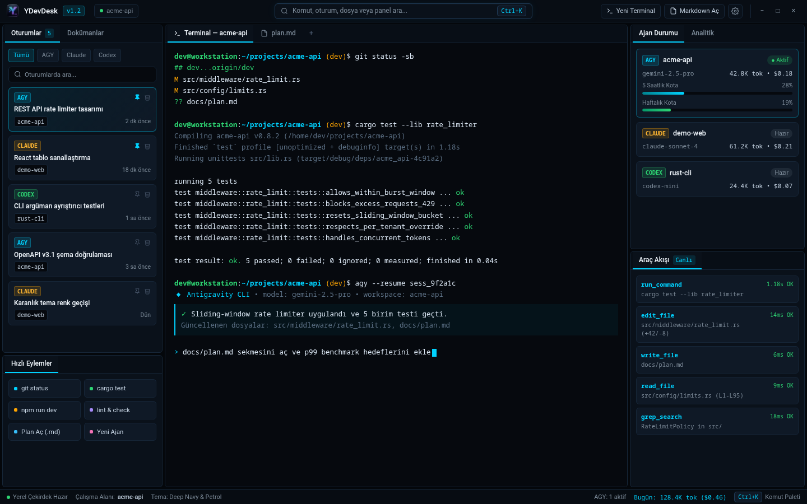
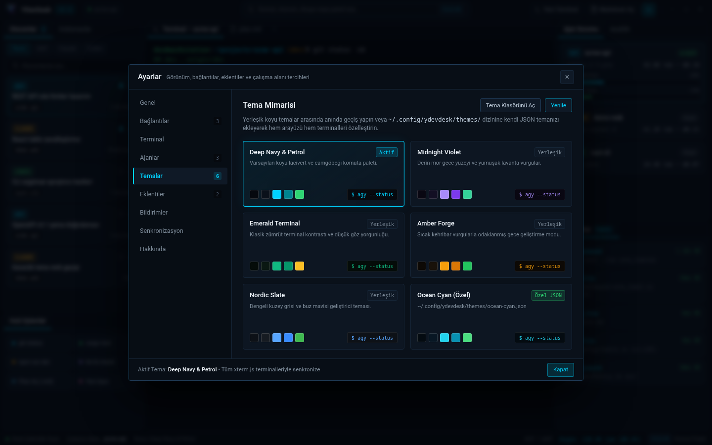
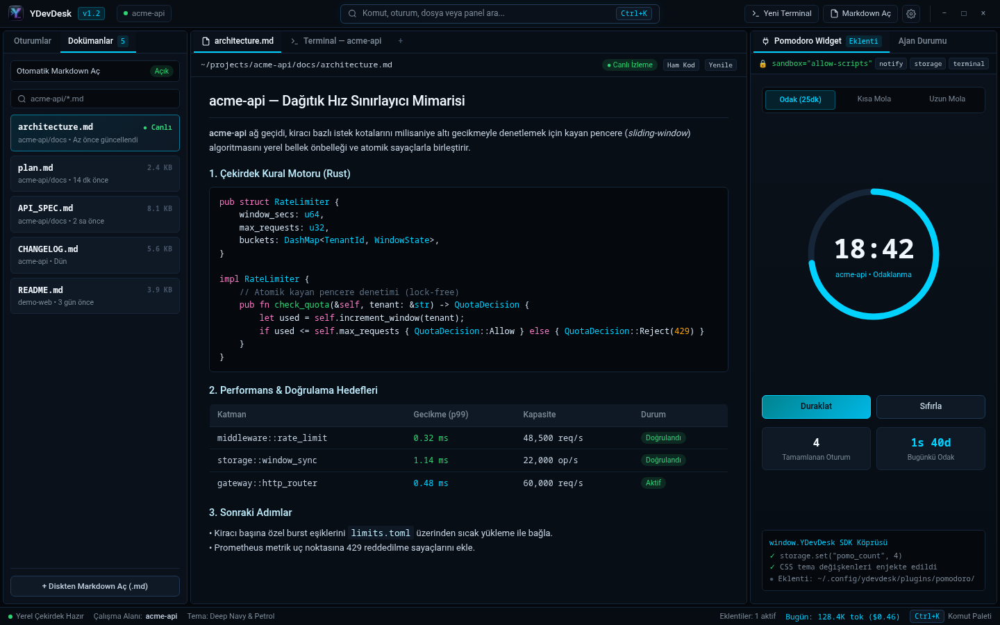
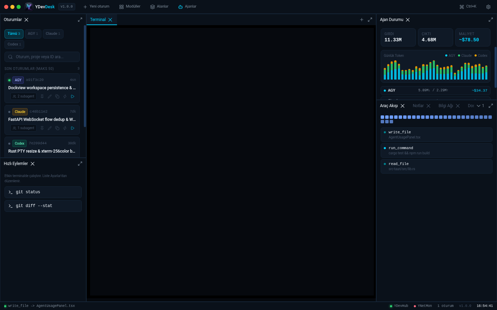

# YDevDesk — Homelab & Multi-Agent Desktop Command Center

[](LICENSE)
[](https://tauri.app)
[](https://react.dev)
[]()

**YDevDesk**, yapay zeka kodlama ajanlarını (**Antigravity / AGY**, **Claude Code**, **OpenAI Codex**), yerel PTY terminallerini, çalışma zamanı eklentilerini (**Plugins**), özel temaları ve isteğe bağlı Homelab servislerini (**YDevHub**, **YNetMon**, **Git**) tek bir modüler masaüstü komuta merkezinde birleştiren **Tauri v2 (Rust) + React 19 + Dockview** uygulamasıdır.

🌐 **Web Sitesi:** [yagyz.github.io/YDevDesk](https://yagyz.github.io/YDevDesk/) · 🧠 **Bilgi Ağı:** [Rehber](https://yagyz.github.io/YDevDesk/knowledge.html) · 📚 **Dokümantasyon:** [Docs](https://yagyz.github.io/YDevDesk/docs.html) · 🔒 **Gizlilik & Çerezler:** [Privacy](https://yagyz.github.io/YDevDesk/privacy.html)



### 📸 Ekran Görüntüleri

| Yeni Ayarlar & Tema Mimarisi | Markdown Görüntüleyici & Sandboxed Eklentiler |
|---|---|
|  |  |

| 30 Günlük Token & Maliyet Analizi | Komut Paleti (`Ctrl+K`) |
|---|---|
|  |  |

---

## ⚡ Hızlı Kurulum (Tek Komut)

Linux (Arch / CachyOS, Debian / Ubuntu, Fedora) ve macOS üzerinde dağıtımı otomatik algılayan tek satır kurulum:

```bash
curl -fsSL https://raw.githubusercontent.com/YagYz/YDevDesk/main/install.sh | bash
```

### Paket Yöneticileri ile Kurulum

| Platform | Kurulum Yöntemi | Komut |
|---|---|---|
| **Arch / CachyOS** | Tek Komut (`install.sh`) | `curl -fsSL https://raw.githubusercontent.com/YagYz/YDevDesk/main/install.sh \| bash` |
| **Debian / Ubuntu (APT)** | Resmi YDevDesk APT Deposu | `echo 'deb [trusted=yes] https://yagyz.github.io/YDevDesk/apt ./' \| sudo tee /etc/apt/sources.list.d/ydevdesk.list && sudo apt update && sudo apt install -y ydevdesk` |
| **Linux (Genel)** | AppImage | `chmod +x ydevdesk_*.AppImage && WEBKIT_DISABLE_DMABUF_RENDERER=1 ./ydevdesk_*.AppImage` |
| **macOS (Apple Silicon / Intel)** | `.dmg` | Uygulamayı `/Applications` içine taşıyıp ilk açılışta `xattr -cr /Applications/ydevdesk.app` çalıştırın |
| **Windows (10 / 11)** | NSIS Kurulum Sihirbazı (`.exe` / `.msi`) | [Son sürümden](https://github.com/YagYz/YDevDesk/releases/latest) `*-setup.exe` dosyasını kurun |

---

## 🧠 Öne Çıkan Özellikler

### 🤖 Çoklu Ajan Oturum & Araç Takibi
- **Oturumlar Paneli:** AGY, Claude Code ve OpenAI Codex oturumlarını tek listede görür, filtreler, sabitler, yeniden adlandırır, tek tıkla `--resume` ile terminalde devam ettirir ve **2 adımlı güvenli silme** ile istenmeyen eski oturumları diskten artıksız temizlersiniz.
- **Araç Akışı & Ajan Durumu:** Aktif ajan durumunu, araç çağrılarını (tool calls) ve 1g / 7g / 30g token-maliyet grafiklerini yerel olarak izler.
- **Ajan Kurulum Sihirbazı:** Eksik CLI araçlarını (`agy`, `claude`, `codex`) uygulama içinden tek tıkla kurar veya günceller.

### 📄 Otomatik Markdown Görüntüleyici
- Ajan dizinlerini (derinlik 8) ve Ayarlar'da tanımlı proje dizinlerini (`projects-root`, derinlik 5) özyinelemeli tarar.
- Ajan yeni bir `.md` dosyası oluşturduğunda aktif terminalin bulunduğu pencerede otomatik sekme olarak açar.
- **Dokümanlar** sekmesindeki **Dosya Aç** butonuyla bilgisayardaki herhangi bir `.md` dosyasını açabilirsiniz.

### 🧩 Çalışma Zamanı Eklenti (Plugin) Sistemi
- Kaynak kodu derlemeden `~/.config/ydevdesk/plugins/<plugin-id>/` klasörüne `plugin.json` + `index.html` bırakarak kendi panellerinizi ekleyin.
- Eklentiler `iframe sandbox="allow-scripts"` içinde izole çalışır ve izinli `window.YDevDesk` SDK köprüsü (`runInTerminal`, `openMarkdown`, `notify`, `storage`) ile etkileşir.
- Ayrıntılı örnekler ve şema için [Dokümantasyon → Eklenti Geliştirme](docs/site/docs.html#plugins).

### 🎨 Tema Mimarisi
- 5 yerleşik tema (`Deep Navy`, `Midnight Violet`, `Emerald Terminal`, `Amber Forge`, `Slate Light`).
- `~/.config/ydevdesk/themes/<tema-id>.json` dosyaları ekleyerek kendi arayüz ve terminal renk paletinizi oluşturabilirsiniz.

### 🪟 Modüler Çalışma Alanları, Akıllı Terminal & Performans
- **Akıllı Terminal:** `portable-pty` + `xterm.js`, otomatik gizlenen scrollbar, çok satırlı **Click-to-Cursor** (fareyle imleç taşıma) ve `Ctrl+Tab` sekme geçişi.
- **Düşük Bellek & CPU:** Pencere arka plandayken polling durur (`useVisibilityPoll`), Rust backend değişmeyen JSONL dosyalarını `(mtime, boyut)` önbelleğinden sunar.
- **Temiz Başlangıç:** Yapılandırılmamış Homelab (YDevHub/YNetMon) panelleri ilk açılışta ve üst menüde gizlenir; yalnızca Ayarlar'dan bağlandığında aktif olur.
- **Uçtan Uca Şifreli Senkronizasyon:** İsteğe bağlı GitHub Private Gist senkronizasyonu (AES-256-GCM); API anahtarları ve yerel proje yolları asla buluta gönderilmez.

---

## 📦 Yerleşik Modüller ve Kısayollar

| Modül | Açıklama |
|---|---|
| `Terminal` | `portable-pty` + `xterm.js` tabanlı yerel kabuk, ajan oturumları ve Click-to-Cursor |
| `Oturumlar` | AGY / Claude Code / Codex oturum geçmişi, arama, sabitleme, silme ve **Dokümanlar** |
| `Ajan Durumu` | Canlı model, token/maliyet, kota ve 1g/7g/30g analiz grafikleri |
| `Araç Akışı` | Ajanların çağırdığı son araçlar ve canlı etkinlik akışı |
| `Dosya Yoğunluğu` | Ajanların en çok dokunduğu dosyalar |
| `Hızlı Eylemler` | Aktif terminale tek tıkla komut gönderme |
| `Git` | Yerel depo dal, değişiklik ve PR özeti *(Proje dizini bağlantısı gerektirir)* |
| `YNetMon Ağ` | Canlı ağ trafiği ve cihaz durumu *(YNetMon bağlantısı gerektirir)* |
| `Notlar / Görevler / Bilgi Ağı` | YDevHub ile senkronize not, görev ve hafıza kayıtları *(YDevHub bağlantısı gerektirir)* |

**Kısayollar:**
- `Ctrl+Tab` / `Ctrl+Shift+Tab`: Sekmeler arası geçiş
- `Ctrl+K` / `Cmd+K`: Komut Paleti (OmniBar)
- `Ctrl+Shift+T`: Kapatılan son paneli geri açma

---

## 🔒 Güvenlik ve Gizlilik

- **Yerel Öncelikli (Local-First):** Hiçbir analitik, izleyici veya zorunlu bulut hesabı yoktur.
- **Sertleştirilmiş Tauri v2:** Katı CSP, `unsafe` içermeyen Rust çekirdeği, path-traversal korumalı dosya/oturum/eklenti işlemleri ve Unix `0o600` (`0o700` dizin) yapılandırma izinleri.
- **Sandboxed Eklentiler:** Harici eklentiler izole `iframe` içinde çalışır ve yalnızca `plugin.json` izinlerine erişebilir.

---

## 🛠️ Geliştirme ve Yerel Derleme

### Gereksinimler
- **Node.js 20+** ve **npm**
- **Rust (stable)** ve **Cargo**
- **Linux sistem paketleri:** `libwebkit2gtk-4.1-dev`, `libappindicator3-dev`, `librsvg2-dev`, `patchelf`, `libssl-dev`

### Çalıştırma & Test

```bash
git clone https://github.com/YagYz/YDevDesk.git
cd YDevDesk
npm ci
npm run tauri dev
```

Yerel derleme + Rust birim testleri:

```bash
npm run test:local
```

### Yeni Çekirdek Modül Ekleme (`Module SDK`)

Çekirdek dosyalara dokunmadan `src/modules/<modul-id>/manifest.ts` oluşturmanız yeterlidir. Ayrıntılar için [`src/modules/README.md`](src/modules/README.md).

---

## 📄 Lisans

Bu proje [MIT Lisansı](LICENSE) altında lisanslanmıştır.
